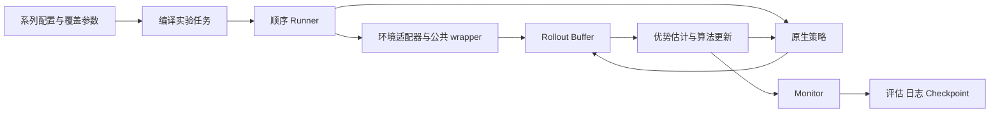

# 框架架构与协议

## 运行链路

| 模块 | 职责 |
|---|---|
| oprl | 命令行入口 |
| workflow | 配置展开、算法发现、任务执行、commit 源码隔离、monitor/report |
| common/env | 各后端适配、终止语义、公共 wrapper |
| architecture | 观测骨干、动作分布与辅助头、策略组装 |
| protocol | buffer 字段、采样与 mask 的声明 |
| memory | 按 schema 分配与采样 rollout |
| onpolicy | 算法估计器、损失与更新流程 |
| common | 日志、计时、评估、checkpoint 等基础能力 |

## 环境协议

reset(seed) 返回批量 obs；step(actions) 返回 obs/reward/masks/info。
masks 包含 terminated、truncated、valid；info 提供 _transition_obs 和原始完成 episode 统计。
自动 reset 返回的新 obs 不能代替被截断 episode 的最后状态。
公共 TensorTransforms 位于后端外侧，两种后端共享归一化、动作缩放与历史拼接。

## 策略协议

常规 ActorCritic 提供 act → action/logp/value，evaluate(obs,action) → logp/entropy/value，
predict_value → bootstrap value，dist → 分类或对角高斯分布。
策略负责动作维度的 log-prob 求和，算法不猜测分布类型；V-MPO 等需要额外分布能力。
辅助头在该协议上扩展 advantages 或 relative_value。

Transformer 使用显式观测窗口，不把可变记忆藏在 module.forward 里。
Diffusion 扩展 sample_chain/evaluate_chain，声明 requires_denoising_chain；DPPO 负责专用字段。
普通算法拒绝 Diffusion 的边缘 log-prob 请求，详见网络页。

## Rollout 与更新

字段声明来自 protocol.buffer.Field，核心形状为 [T,N,...]。
NativeLoop 收集 obs、action、logprob、value、reward、next_obs/next_value 和 masks。
优势估计写入 advantages/returns；采样排除无效 transition；截断保留 bootstrap，终止截断未来价值。
DPPO 通过 extra_schema 增加 chain 与逐步概率，不更改核心字段的含义。

## 状态归属

环境拥有仿真状态；wrapper 拥有归一化与历史；policy 拥有网络/优化器；算法拥有 buffer、步数和 update 计数。
Monitor 编排评估和 checkpoint，不通过异常检测主动停止训练。
Runner 组装这些对象、记录配置、关闭资源；并按顺序运行 jobs。
checkpoint 保存策略、优化器、RNG、计数和 wrapper 统计，不能恢复整个模拟器运行现场。

固定 commit 只隔离源码，不隔离整个操作系统或 Python 依赖环境。
算法/网络扩展方式见 [开发指南](development.md)。
